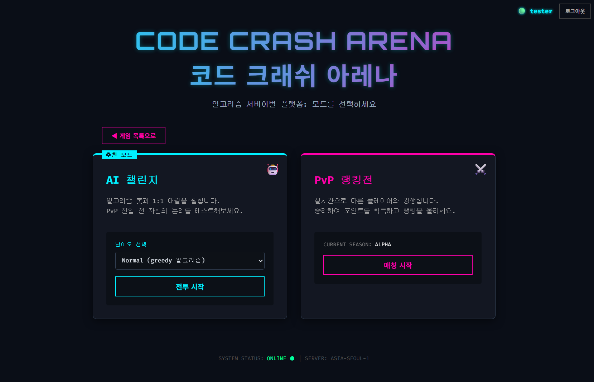
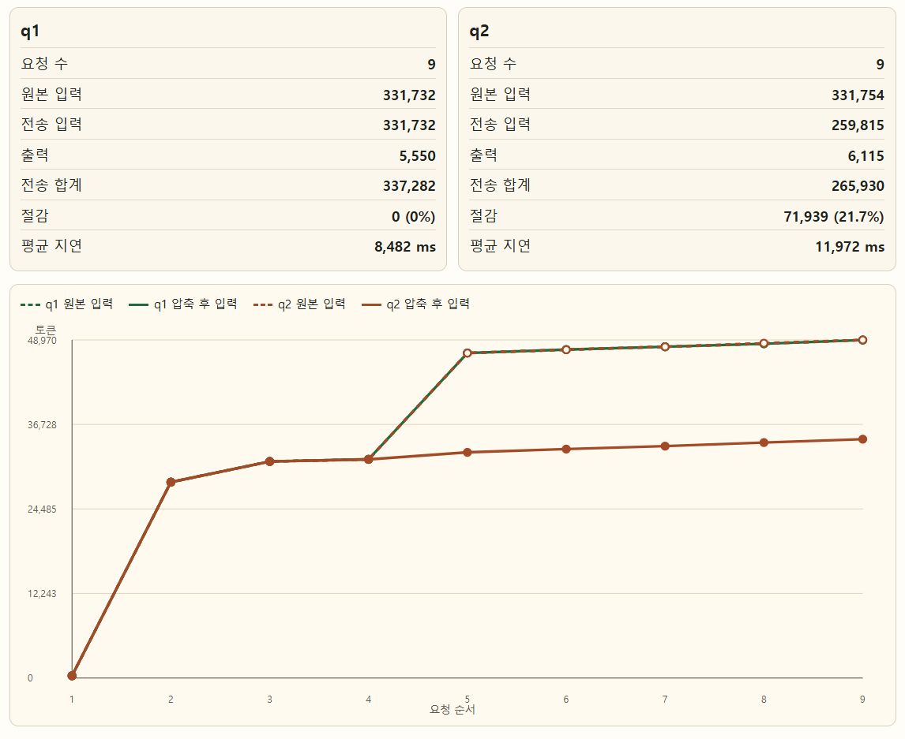
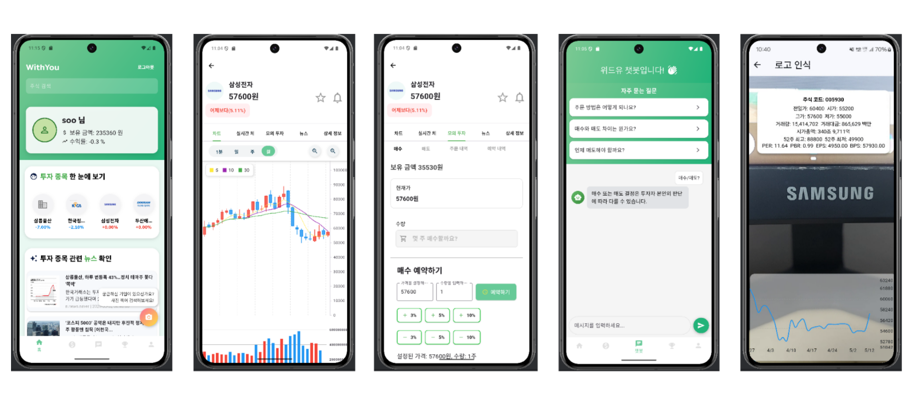
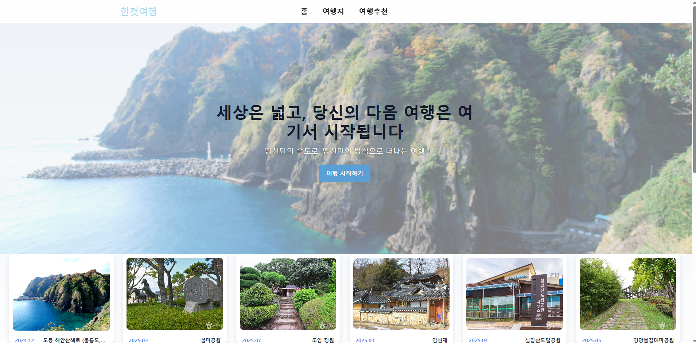

# Eunjung's Github Profile

**동시에 요청이 들어오거나 연결이 끊겼을 때 서비스가 어떻게 동작하는지까지 확인하는 백엔드 개발자입니다.**

---

## 기술 스택

### Backend & Languages

### Infrastructure & Database

### Tools & Collaboration

---

## 주요 프로젝트

### Code Crash Arena (실시간 1:1 알고리즘 대결 서비스)
**개인 프로젝트** (초기 개발 2025.11~2025.12, 후속 수정 2026.08~2026.09.16)

두 사용자가 제출한 코드를 채점하고 승패를 기록합니다.

**기술 스택**

Java 17, Spring Boot, WebSocket, Redis, Docker

- 매칭 대기열을 Redis ZSET으로 옮겼습니다. ZPOPMIN으로 가장 오래 기다린 사용자를 조회와 동시에 큐에서 제거해 중복 매칭을 막았습니다.
- 제출한 코드는 언어별 Docker 컨테이너에서 컴파일하고 실행합니다. 채점이 끝나면 임시 자원을 정리합니다.
- 대기실과 게임 상태를 Redis에 나눠 저장합니다. 연결이 끊겨도 정해진 시간 안에는 같은 게임으로 돌아갈 수 있고, 시간이 지나면 기권으로 처리합니다.
- 후속 수정에서는 대결 번호로 매칭부터 결과 저장까지의 로그를 연결했습니다. 실제 DB와 브라우저에서 경기 흐름과 장애 복구를 확인하는 자동 검사를 추가했습니다.

 

### [우리집 보수 알림이](https://github.com/Urasica/house-repair-Notification) (LH 임대주택 보수 안내)
**개인 프로젝트** (2026.10~2026.11)

입주민이 설문이나 챗봇에 집 안의 증상을 입력하면 관련 기준과 관리사무소에 전할 내용을 확인할 수 있습니다.

**기술 스택**

Python, FastAPI, PostgreSQL, pgvector, React, Docker, Jenkins, Prometheus, Grafana

- 검토한 조문과 별표를 pgvector로 검색하고, 기준을 설명할 때 출처를 함께 표시합니다. 실제 보수 처리에 적용할 근거가 부족하면 담당 기관에 문의할 내용을 정리합니다.
- 비회원 설문과 회원 챗봇의 세션을 나눴습니다. 로그인한 사용자는 본인이 작성한 설문을 골라 대화에 불러올 수 있습니다.
- 근거가 부족할 때와 검색이나 연결에 실패했을 때 각각 다른 상태를 기록했습니다. Prometheus와 Grafana에서 이 상태를 확인할 수 있습니다. Jenkins 파이프라인의 실행 스크립트로 격리 Docker 환경에서 DB 복구와 암호화 백업 복원을 확인했습니다.

 

### [CCIM](https://github.com/Urasica/CCIM) (Coding-agent Context & Integrity Middleware)
**개인 프로젝트** (2026.04~2026.05)

코딩 에이전트가 LLM에 반복해서 보내는 파일 읽기 결과와 도구 출력을 줄여 주는 로컬 미들웨어입니다. 필요할 때 원문을 다시 읽을 수 있습니다.

**기술 스택**

Python, FastAPI, Redis, PostgreSQL, Docker, tree-sitter

- Python, Java, C# 코드를 AST로 분석해 함수와 메서드 본문을 압축했습니다. 시그니처와 호출 관계를 남기고, 현재 턴에서 읽은 큰 파일도 바로 압축합니다.
- 압축하기 전 원문을 Redis에 저장하고 retrieve_original로 복구합니다. 원문을 확인하지 않은 Edit, MultiEdit, Write 요청은 Write Guard가 막습니다.
- 요청별 원본 토큰 수와 전송 토큰 수, 지연 시간, 압축과 복구, 차단이 일어난 이유를 PostgreSQL에 기록합니다. 관리자 화면에서 요청별 기록을 비교할 수 있습니다.
- 같은 9개 요청 시나리오에서 품질 회귀 검사를 통과했고 전송 입력 토큰이 **71,939개(21.7%)** 줄었습니다. 평균 응답 시간은 늘었습니다.

 

### 위드유 (AI 활용 주식 모의투자 플랫폼)
**4인 팀 프로젝트, 팀장** (2025.03~2025.06)

실제 시세로 가상 거래를 하고 챗봇에 종목 정보를 물어볼 수 있는 모의투자 서비스입니다.

**기술 스택**

Spring Boot, Redis, GCP, Flutter

- 회원과 거래 내역은 RDB에 저장하고 자주 읽는 시세는 Redis에 캐시했습니다. 캐시에 Read-Through와 Write-Back 방식을 적용했습니다.
- synchronized로 증권사 API 요청을 한 번에 하나씩 처리하고 호출 간격을 제한했습니다. 실패한 요청은 큐에 다시 넣어 재시도했습니다.
- 모델이 요청 유형과 인자를 JSON으로 돌려주면 필요한 내부 API를 호출하고, 조회한 시세를 답변에 포함했습니다.

 

### 한컷여행 (여행 경로 추천 및 공유 서비스)
**3인 팀 프로젝트, 팀장** (2025.07~2025.09)

한국관광공사 Open API로 관광지를 찾고 여행 경로를 만들어 공유하는 서비스입니다.

**기술 스택**

Spring Boot, JPA, MariaDB, AWS (EC2/RDS), Docker

- 관광 API마다 필드 이름과 형식이 달라 공통 모델로 변환했습니다. API마다 다른 추가 필드는 메타데이터에 남겼습니다.
- API 사이에 공통 관광지 ID가 없어서 이름으로 후보를 찾고 위도와 경도로 계산한 거리로 같은 장소인지 확인했습니다.
- AWS에서 Docker로 서비스를 배포했습니다. Route 53으로 도메인을 연결하고 HTTPS를 적용했습니다.

---
